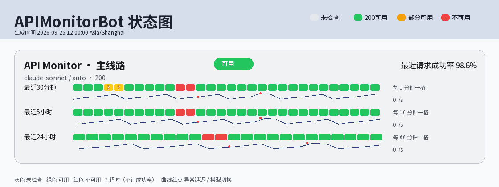
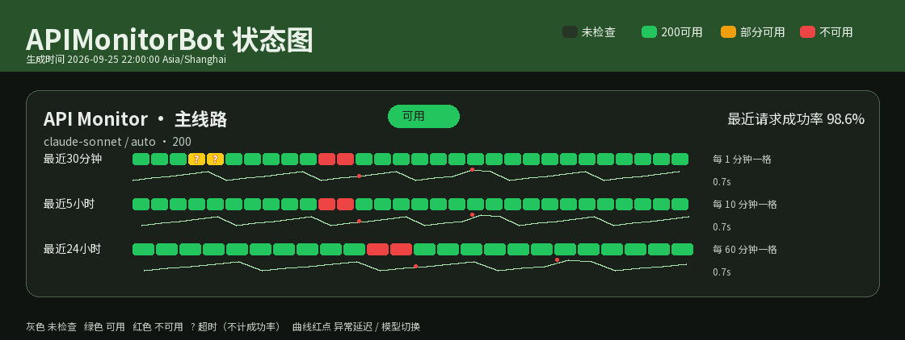
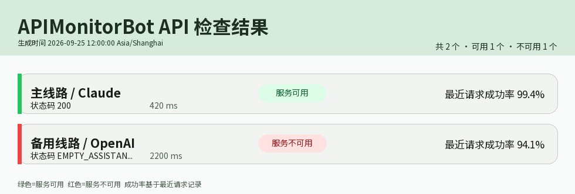
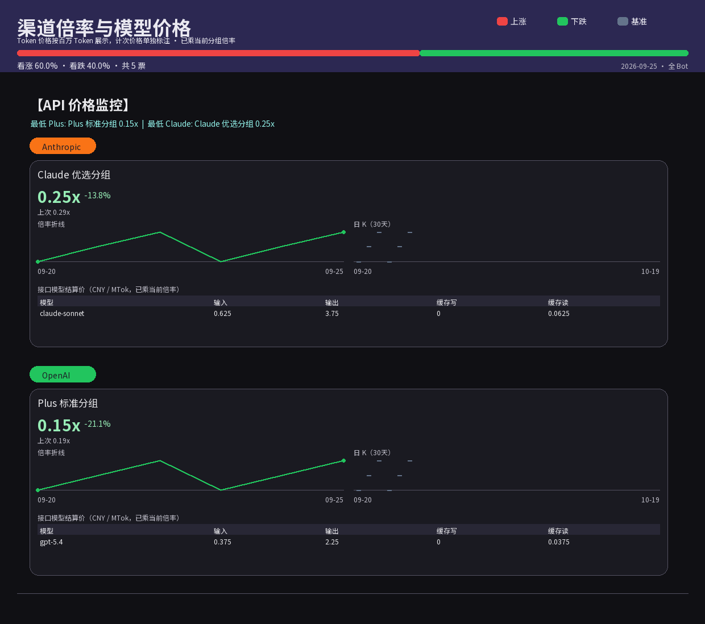
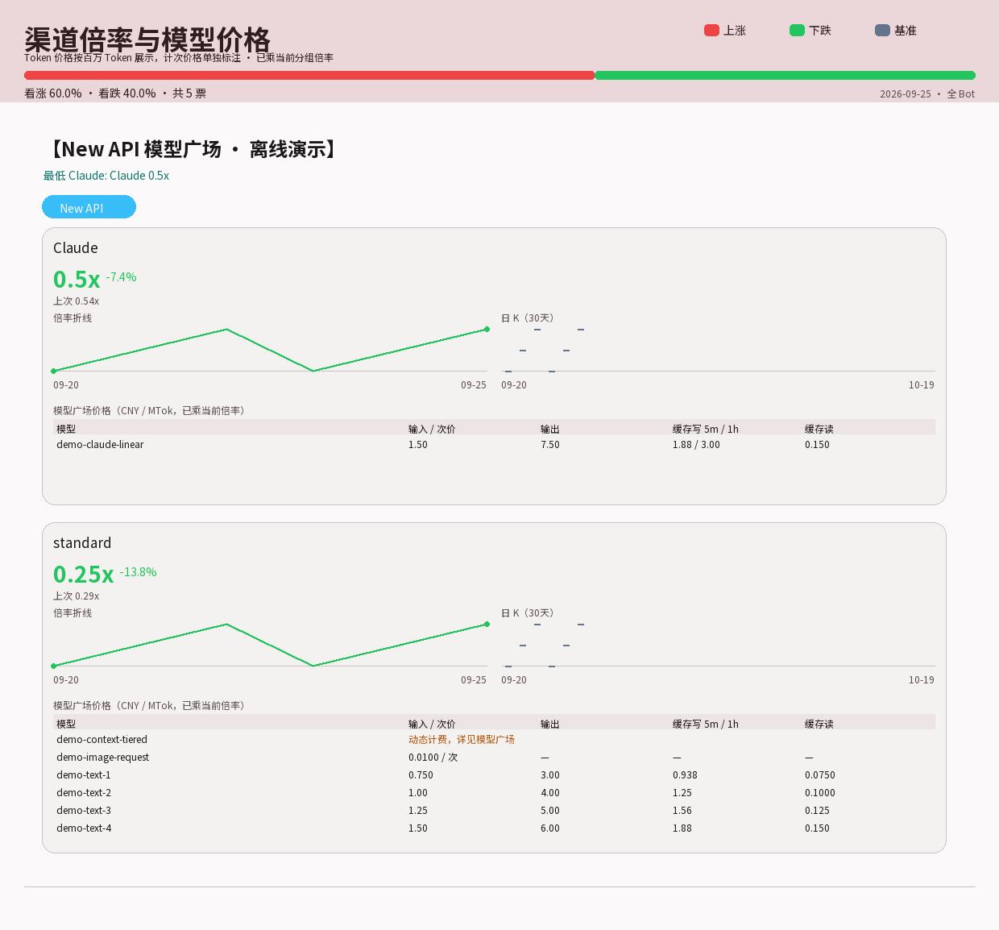
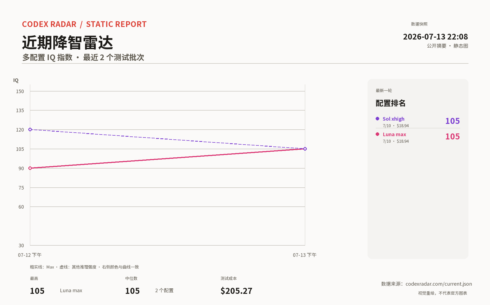
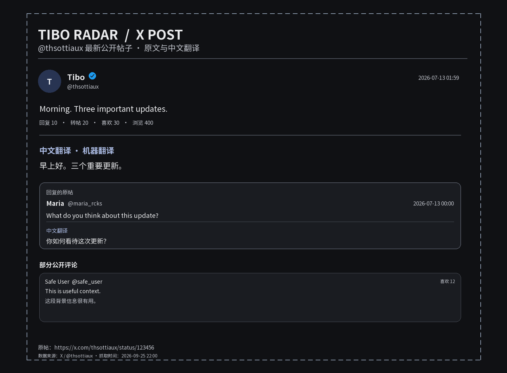
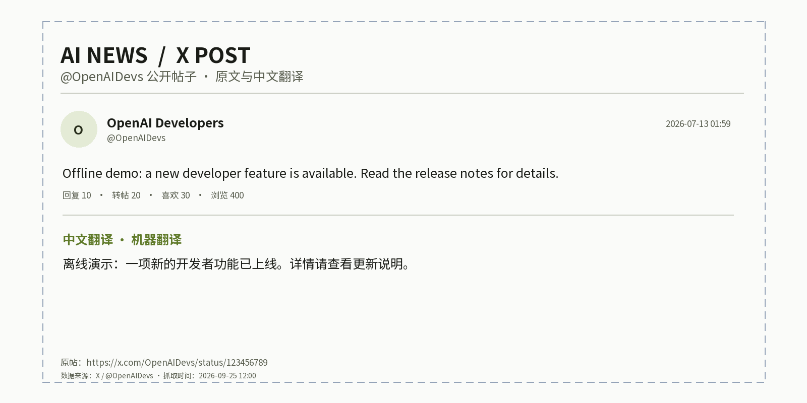
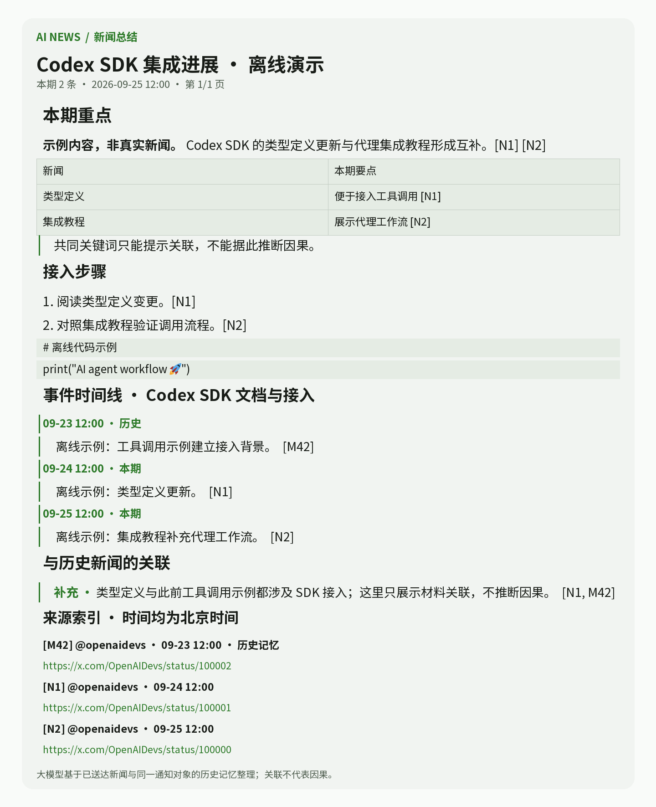

# APIMonitorBot

面向 OpenAI / Anthropic 兼容接口的 API 可用性监控与 QQ 通知机器人。

在一个 WebUI 中管理多个 API、查看状态和延迟、跟踪渠道倍率，并通过 OneBot v11 将故障、恢复和价格变化发送到指定群聊或私聊。项目可独立运行，适合本机或自托管部署。

[快速部署](#快速部署) · [机器人命令](#机器人命令) · [渠道倍率与价格](#渠道倍率与价格) · [配置与运维](#配置与运维) · [开发与离线验收](#开发与离线验收)

## 效果预览

以下图片由项目真实渲染器使用**离线演示数据**生成，不代表实际服务可用性、模型表现或报价。图片随仓库保存，无需运行服务即可查看。

### API 状态与延迟

状态条和延迟曲线分别展示最近 30 分钟、5 小时及 24 小时的数据。

| 北京时间白天 · 浅色 | 北京时间夜间 · 深色 |
| --- | --- |
|  |  |

### 即时检查与渠道价格

| 多接口检查结果 | 渠道倍率、历史走势与模型价格 |
| --- | --- |
|  |  |

<details>
<summary>New API 模型广场：分组模型、Token 价、计次价与动态计费</summary>



</details>

<details>
<summary>更多图片：Radar、Tibo 与 AI 消息推送</summary>







</details>

自产报告图片共用 Material 3 风格的色彩角色、字体和布局。每次渲染重新选择主题色，北京时间 **07:00 至 19:00 为浅色，其余时间为深色**；成功、失败、涨跌等语义色保持一致。

## 主要功能

| 模块 | 能力 |
| --- | --- |
| API 监控 | 多配置、协议选择、定时巡检、失败复核、模型回退、故障与恢复通知 |
| 状态分析 | 滚动 24 小时成功率、三档时间窗口、独立超时展示、延迟曲线及异常标记 |
| QQ 机器人 | OneBot v11 WebSocket 收发、群聊与私聊通知、多目标绑定、管理员权限、命令开关与别名 |
| AI 消息 | 69 个公司、产品与人物账号预设，离线彩色 emoji、大模型翻译，按账号去重与重试 |
| 新闻总结 | 每 N 条送达后追加 Markdown 总结图，支持事件时间线、加密记忆与历史关联 |
| 渠道价格 | Sub2API / New API 分组倍率、模型广场价格、历史折线、30 日日 K、看涨/看跌投票、地址导入 |
| 管理后台 | 登录鉴权、配置管理、巡检历史、消息记录、巡检参数、管理员管理、本地升级 |
| 公开状态 | 默认关闭的 `/status` 页面，按分组开放，只读取本地快照 |
| 群聊情报 | 默认关闭、群白名单、上下文采集、规则筛选、可选 LLM 分析、管理员报告 |
| 扩展报告 | Codex Radar 公开趋势摘要、Tibo 公开动态与中文翻译 |

后端使用 **FastAPI + SQLAlchemy + SQLite + APScheduler**，前端使用 **React + TypeScript + Vite**，图片使用 **Pillow + Noto Sans SC**。

## 快速部署

下面以 Windows PowerShell 为例。需要 Python 3.11+、Node.js 20+ 和兼容 OneBot v11 的机器人服务；推荐使用 NapCat 的 WebSocket Server。

### 1. 获取代码和安装依赖

```powershell
git clone https://github.com/mcyh234/APIMonitorBot.git
cd APIMonitorBot
python -m venv .venv
.\.venv\Scripts\python.exe -m pip install -r requirements.txt
Copy-Item .env.example .env
.\.venv\Scripts\python.exe scripts/generate_secret_key.py
```

将生成的密钥填入 `.env` 的 `SECRET_MASTER_KEY`。这是数据库敏感字段的加密主密钥，**不是 WebUI 登录密钥**；请妥善备份，不要在升级时重新生成。

同时将 `.env` 中的 `DEFAULT_ADMIN_QQ` 改为自己的 QQ 号。模板包含默认管理员，部署后请在 WebUI 核对管理员列表，删除不属于自己的账号。

### 2. 构建并启动

```powershell
cd frontend
npm ci
npm run build
cd ..
.\.venv\Scripts\python.exe run.py
```

打开 <http://127.0.0.1:8000>，首次访问设置 WebUI 进入密钥，然后配置管理员、OneBot 连接和 API。

Linux/macOS 对应使用 `.venv/bin/python` 和 `cp .env.example .env`；其余构建步骤相同。

### 3. 连接 QQ 机器人

1. 在 NapCat 中开启 **WebSocket Server**，设置访问 token。
2. 在 WebUI 中填写服务器地址，例如 `ws://127.0.0.1:3001`，以及相同 token。
3. 按适配器需要启用 query token 兼容选项，保存并确认连接成功。
4. 添加 API，设置通知目标，例如 `G123456789`、`P1122334455`，多个目标使用 `&` 连接。

消息接收与发送均通过 WebSocket 完成。新部署不需要配置 OneBot HTTP 发送或 HTTP webhook。

## 探测与通知

### 协议和 TLS

- `auto`：根据配置推断协议；自动推断 Claude 协议后遇到 404/405，可回退 OpenAI 兼容端点。
- `openai`：使用 Chat Completions 探测，不发送输出 token 上限参数。
- `anthropic`：使用 Messages 探测，携带协议必需的 `max_tokens`。
- 显式指定的协议不会自动切换。探测发送 `hi`，需要 HTTP 成功、JSON 可解析且有 assistant 内容。
- **TLS 保留旧配置兼容性**：默认不强制验证证书，可在每个 API 的连接设置中主动开启。关闭验证存在中间人攻击风险，证书正常的服务建议开启。

### 巡检规则

默认每 60 秒巡检，夜间省流默认在北京时间 00:00 至 08:00 调整为每 10 分钟探测一次。巡检参数可在 WebUI 修改，Sub2API 倍率检测独立按分钟执行。

首次失败会复核，符合条件时尝试模型回退；确认业务中断后通知，持续故障按策略提醒，连续恢复成功后发送恢复通知。同一轮发往同一对象的多个状态变化合并报告。

### 如何理解图表

- 最近请求成功率采用**滚动 24 小时**口径。兼容 API 字段 `today_availability` 保留原名。
- 状态条仅使用定时巡检数据，手动检查不改变状态条。
- 绿色表示可用，黄色表示部分可用，红色表示不可用，灰色表示无检查数据。
- `TIMEOUT` 单独写入观察数据，不计入可用性分母，不触发业务中断通知；`NETWORK_ERROR` 同样不计入业务可用性。
- 分钟级视图显示超时标记；5 小时和 24 小时聚合视图仅在整个窗口超时观察占比**严格大于 40%**时显示。
- 延迟按时间桶中位数聚合，异常高延迟及模型切换以红点标记。
- 超时时可额外检测国际网络连通性，断网提醒发往默认管理员。

## 机器人命令

| 命令 | 用途 |
| --- | --- |
| `/addapi [auto\|openai\|anthropic]` | 管理员多轮添加 API，密钥必须私聊输入 |
| `/addsub2` | 管理员多轮添加 Sub2API，密码必须私聊输入 |
| `/list` | 管理员查看全部 API 配置 |
| `/remove <名称>` | 管理员删除配置 |
| `/check [名称]` | 即时检查，不带名称时汇总当前通知对象绑定的 API |
| `/status [名称]` | 生成状态条及延迟图片 |
| `/price` | 生成绑定的 Sub2API / New API 分组倍率、历史和模型价格图片 |
| `/up`、`up` / `/down`、`down` | 看涨/看跌投票，每个 QQ 每个北京时间自然日一票，当天可改票 |
| `/radar` | 生成 Codex Radar 公开趋势报告 |
| `/tibo` | 自动读取 X @thsottiaux 最新公开帖子，发送原文与中文翻译 |
| `/tibowatch [G群号&PQQ号\|on\|off\|status]` | 管理员配置 Tibo 新帖自动推送，支持群聊和私聊 |
| `/newswatch` | 管理员配置多账号 AI 消息推送；支持通知对象、`on/off/status/accounts`、`recommend/all`、`add/remove @账号` |
| `/reviewmodel [list\|status\|配置ID或名称\|default]` | 管理员从已有监测配置选择审核模型，`default` 恢复情报分析模型 |
| `/translatemodel [list\|status\|配置ID或名称\|default]` | 管理员独立选择大模型翻译；`default` 恢复公开机器翻译 |
| `/summarymodel [list\|status\|配置ID或名称\|default]` | 管理员选择新闻总结模型；`default` 跟随审核模型 |
| `/newssummary` | 管理员配置总结开关、条数、最长等待、时间线、记忆，以及手动总结和历史查询 |
| `/cancel` | 取消当前多轮对话 |

普通用户的查询命令默认冷却 5 分钟，管理员不受此限制。群聊普通用户只能查询本群绑定配置，私聊命令默认仅管理员可用。WebUI 可维护命令开关与别名，`/cancel` 始终保留。

### Tibo 雷达

每次调用 `/tibo` 都会从 `@thsottiaux` 的账号时间线选择最新公开帖子（包含回复、排除转帖），不会把旧置顶帖当作最新帖。图片展示原文、中文机器翻译、发布时间、原帖链接和可用的回复上下文；已移除区域判断、位置概率和相关摘要。

默认并行读取 FxTwitter 与 3 个 Nitter RSS 实例，合并、去重后选择最新帖子，无需 X Token；成功但不完整的来源不会阻止其他来源补充帖子。来源及实测记录见 [RSS 来源维护](docs/ai-news-sources.md)，[FxTwitter 订阅格式说明](https://docs.fxembed.com/guide/advanced/rss-atom-feeds/)。只解析 `@thsottiaux` 本人发布的帖子，旧 Codex Radar 来源配置会自动使用新的默认 RSS。

可选填写 `TIBO_X_BEARER_TOKEN`，优先使用 [X 官方账号时间线 API](https://docs.x.com/x-api/users/get-posts)，失败时仍可回退 RSS。FixupX 与 FxTwitter 共用上游，不再把 FixupX 当作独立备用来源。不同 Nitter 实例仍可能共同受到 X 上游限制。

中文翻译优先使用 Google Translate 公开接口，失败时通过 MyMemory 的英文转中文接口回退，长帖按服务限制分段翻译。两者均失败时报告内部标注“翻译暂不可用”，发送前的严格过滤会拦截该帖子；时间线获取失败时明确报错，不用旧摘要替代最新帖子。X API Token 仅发送到 X 官方 API，不发送到翻译服务或自定义时间线。

### AI 多账号消息推送

监听默认关闭，可在 WebUI 的「监控管理 → AI 消息监听」中设置账号、开关、通知对象和检查间隔。内置 **69 个账号**，按公司、产品、负责人和创始人分类，支持搜索、按类选择、推荐组合、全部选择及自定义 X 用户名。覆盖 OpenAI、Anthropic、Google、xAI、Meta、Microsoft、DeepSeek、Qwen、Kimi、MiniMax、Z.ai、StepFun、Mistral，以及推理平台、编程代理和多媒体产品，包含崔天翼 `@tianyi` 的 DeepSeek Harness 动态。[账号推荐与来源](docs/ai-news-accounts.md)。

新安装预选推荐组合；旧安装保留已有 Tibo 订阅、通知对象和开关，升级不会自动扩大正在推送的账号范围。可点击「加入全部账号」并保存，或使用 `/newswatch all` 加入完整账号库。人物账号可能发布非 AI 话题，Grok 等互动账号消息较多，可单独取消。

配置保存在 SQLite，重启后保留。默认每 120 秒检查一次，允许设置 60–3600 秒；每轮最多抓取 12 个到期账号，最多并发 4 个，其余账号随后继续，避免单个故障来源阻塞整个账号库。实际推送延迟还受 RSS 缓存、分批检查和翻译耗时影响。WebUI 可查看每个账号的抓取进度与错误。

Bot 管理员也可通过命令配置同一份设置：

```text
/newswatch all
/newswatch G123456789&P1122334455
/newswatch status
/newswatch accounts
/newswatch add @OpenAI
/newswatch remove @elonmusk
/newswatch off
/newswatch on
```

`recommend` 加入推荐组合，`all` 加入全部预设，均保留已选自定义账号；WebUI 可清空或按类取消。`/tibowatch` 保留兼容，操作同一份监听设置；两个命令均有独立命令开关，且只允许 Bot 管理员配置。

填写通知对象会保存并启用监听；`G` 后填群号，`P` 后填私聊 QQ 号，多个对象用 `&` 连接。`off` 暂停监听和发送，`on` 使用已保存对象恢复。每个账号首次成功检查只建立基线，不推送订阅源已有的历史帖子；新增或移除后重新添加账号也是如此。后续读取到的多条新帖分别生成原文与翻译图片，图片显示实际账号、发布时间和原帖链接。排除转帖，包含本人原创和回复。

发送进度按账号、帖子和通知对象保存；发送成功的对象不会因其他对象失败而重复接收，失败会逐步延长重试间隔，最长一小时。每轮最多处理三条帖子的推送，重启后继续处理待发送记录。移除账号或通知对象时清理对应待发送项，新增对象只接收之后发现的新帖。待发送内容加密保存，发送审计只保留图片短预览。

所有账号复用 Tibo 的 RSS / X API 拉取与翻译流程。`TIBO_RADAR_SOURCE_URL` 填写单一 URL 时仅影响 Tibo；包含 `{username}` 时应用于所有账号。也可用 `TIBO_RADAR_SOURCE_URLS` 配置最多 12 个 URL 的 JSON 数组，替换内置来源池；单一设置非空时也会加入池中。修改 `.env` 后重启生效。X Token 始终只发送给 X 官方 API。

HTTP 429、503 会触发同来源跨账号退避，尊重 `Retry-After`；其他错误逐步退避。60 秒短时缓存、ETag / Last-Modified 条件请求用于减少重复抓取。WebUI 的「各账号抓取状态」显示各来源条数、限流和退避状态。按账号持久化最近 2048 个已处理帖子 ID；晚到帖子即使小于当前游标，只要高于初次基线且仍在去重窗口内，也会进入严格审核。旧版本升级以原游标建立安全基线，不会自动重放之前的历史帖子。

暂停期间的新帖会在恢复后按订阅源仍保留的数据补发；长时间停机超过订阅源保留范围时不能保证补齐。进程若恰好在 OneBot 已确认发送、SQLite 尚未保存结果之间退出，恢复后仍可能重复投递该条消息。

### 新闻总结、事件时间线与记忆

WebUI「监控管理 → 新闻总结与事件记忆」提供独立开关，**默认关闭，每累计 10 条成功送达的新闻后生成总结**，条数可设为 1–100。各群和私聊独立计数、独立检索记忆；失败发送、重复帖子、手动 `/tibo` 以及总结图片均不计数。生成过程不阻塞原始新闻推送，完成并通过严格审核后追加总结图片。

总结支持 Markdown 标题、加粗、列表、引用、表格、代码块和离线彩色 emoji；长报告自动分页并分别确认投递。可选择简洁、标准或详细模式，填写关注主题，开关事件时间线与历史关联，并设置未满条数时的最长等待。时间线按引用新闻的真实发布时间排序，缺少发布时间时明确标注使用送达时间；历史事件与本期消息分别标记，每条关联都有来源索引和原帖链接。

```text
/summarymodel list
/summarymodel 监测配置ID
/newssummary count 10
/newssummary on
/newssummary status
/newssummary now G123456789
```

WebUI 可查看各对象的累计进度、重试任务、历史总结图片、Markdown 原文与导出，并检索或清空历史记忆。记忆和总结正文加密保存，默认保留 30 天、每个对象 300 条记忆，每次最多检索 12 条相关历史。关闭或清空记忆会删除历史正文，保留尚待总结的新帖。总结缺少可用模型、审核异常或发送失败时暂停并重试；政治、高风险、不确定或无依据的生成内容不会发送。

更多设置、重启与分页续传规则、存储上限及命令示例见 [新闻总结模块说明](docs/ai-news-summary.md)。



### 发送前的严格内容过滤

自动消息推送和手动 `/tibo` 均启用不可关闭的过滤，只有审核明确通过的 AI 技术、模型、API、研究和产品消息才会发送。政治、政府与选举、地缘争议和战争，以及色情、暴力仇恨、极端内容、诈骗赌博、毒品和隐私凭据等高风险内容会被拦截；混合 AI 与政治内容也不放行。个人生活等非 AI 消息一并过滤。

1. 原文在翻译前先做本地规则检查，包含 Unicode、隐藏字符及常见编码归一化。
2. 原文、中文译文、作者名称、原帖链接、可见回复上下文和评论在发送前接受语义审核。外部头像不下载、不进入图片；帖子附件图片和视频也不转发。
3. 管理员可用 `/reviewmodel` 选择已监测模型；未单独选择时复用 WebUI「监控管理 → 群聊情报 → 分析模型」保存的配置，**无需开启群聊情报采集**。审核会将这些公开帖子文本发送到所配置的模型服务。
4. **未配置模型、请求失败、重定向、无效或不完整的审核结果均不发送**；审核不可用时加密排队并退避重试。只有结构有效、明确允许、属于 AI 内容、无风险分类且置信度至少 95 的结果才可继续发送。
5. 内容命中规则、被模型拒绝、判定不确定、非 AI 内容或翻译不可用时，整帖跳过并清理其所有目标的待发送项，游标仍前进，避免重复审核同一条和阻塞后续消息。旧版本遗留待发送记录同样重新检查。

WebUI 和 `/newswatch status` 显示模型是否配置、拦截计数及固定分类原因，审计不记录被拦截正文或模型返回的自由文本。首次启用前请保存并测试分析模型；否则监听仍可建立基线和发现帖子，但不会发送图片。

规则和模型可能误判，无法保证覆盖全部隐晦表达或所有平台审核标准，不构成中国大陆法律或平台过审保证。严格模式采取保守放行策略，审核失败不回退到未经审核的推送。

### 聊天配置审核模型与大模型翻译

先通过 `/addapi` 或 WebUI 添加监测配置，再由管理员选择其 ID 或完整配置名；审核和翻译可选择不同模型，也可复用同一配置。命令不会显示 BaseURL、APIKey 或密文，选择结果只保存配置 ID，后续修改模型或凭据会立即用于新请求。

```text
/reviewmodel list
/reviewmodel 3
/translatemodel list
/translatemodel 5
/reviewmodel status
/translatemodel status
/newswatch add @tianyi
```

`/reviewmodel default` 恢复使用情报分析模型，审核始终不能关闭。`/translatemodel default`（兼容 `off`）恢复公开机器翻译；它不会关闭内容审核。两个配置命令均有独立命令开关，也支持「审核模型」「翻译模型」作为别名。

选择的监测配置必须启用；停用或删除后暂停相关投递，不会悄悄换成其他模型。支持 `auto/openai/anthropic`，沿用配置的 TLS 设置；OpenAI 请求不携带输出 token 上限，Anthropic Messages 携带必需的 `max_tokens`。切换选择会使在途图片失效，并重新尝试因审核或翻译异常而排队的消息。

大模型翻译覆盖原帖、回复背景及显示的评论，优先使用自然的产品与技术表达，原样保留 `@账号`、URL 和 emoji。配置大模型后不再调用公开翻译接口；失败、截断、无效 JSON 或受保护内容丢失时停止发送并重试，不回退到生硬的机器译文。所有最终译文仍接受严格审核。

报告中的 emoji 使用随项目打包的 [Twemoji 17.0.3](https://github.com/jdecked/twemoji/tree/v17.0.3) 离线彩色素材，测宽与换行保持组合表情完整。素材采用 CC BY 4.0，归属和许可证位于 `backend/app/assets/Twemoji-ATTRIBUTION.md` 与 `Twemoji-LICENSE.txt`；尚无素材的未来表情显示可读名称，不显示缺字方框。

已有部署更新后需先运行 `python -m pip install -r requirements.txt` 安装新增的 emoji 解析依赖，再构建前端并重启服务。

## 渠道倍率与价格

### 添加与查询

1. Sub2API 可通过管理员命令 `/addsub2` 添加，或在 WebUI 批量导入上游地址。
2. New API 在 WebUI 导入地址时选择 `newapi`，填写站点根地址或模型广场 `/pricing` 地址，再在价格面板补充登录信息。支持用户名与密码；管理 API 也支持访问令牌与用户 ID。导入后默认停用，登录并成功读取分组后启用。
3. 在绑定的群聊发送 `/price`；私聊仅管理员可查询绑定自己 QQ 的价格配置。多个通知对象使用 `&` 连接。命令开关与普通用户冷却规则同时适用。

首次采样保存倍率基线，不发送变动通知；后续倍率变化或分组删除会发送图片和文字说明。图片展示倍率、历史折线和日 K，New API 按分组完整展开模型列表。停用或价格拉取失败时明确提示仅展示已保存倍率，不使用内置静态价目表。

### Sub2API 价格

倍率来自 `/api/v1/groups/available`，模型单价来自 `/api/v1/channels/available`。

每百万 Token 展示价按 `每 Token 单价 × 1,000,000 × 分组倍率` 计算。项目沿用 Sub2API 的 `1 CNY = 1 USD` 计价单位约定，**不是实时外汇换算**，具体结算以上游为准。

### New API 模型广场

模型价格、分组倍率和可用模型关系来自 `/api/pricing`，只在对应的 `enable_groups` 分组中展示模型。已有登录会话或访问令牌会用于读取账号对应的倍率；倍率监控沿用 `/api/user/self/groups`。

接口结构参考 [New API 模型广场实现](https://github.com/QuantumNous/new-api/blob/main/controller/pricing.go)。

- Token 计费：基础输入价为 `model_ratio × 2 USD / MTok`，再乘分组倍率；输出、缓存读、缓存写分别使用对应倍率。
- 计次计费：`model_price × 分组倍率`，标注 `/ 次`，不换算成百万 Token。
- 单档线性 `tier(...)` 表达式：读取表达式中的输入、输出、缓存读和缓存写价格；缓存写可区分 5 分钟与 1 小时。
- 条件阶梯、插件和其他无法可靠换算的表达式：保留模型并标注“动态计费，详见模型广场”，不拿旧倍率字段冒充价格。接口未提供的缓存价格显示 `—`。
- 币种：读取站点 `/api/status` 的显示币种及换算设置；设置不可用时明确使用 USD，不套用 Sub2API 的计价约定，也不使用外部实时汇率。

历史走势和日 K 按北京时间自然日聚合，没有采样的日期留空。涨为红色，跌为绿色；顶部显示全 Bot 当日投票比例。

## 公开状态与群聊情报

**公开状态页默认关闭。** 启用后访问 `/status`，并逐个勾选公开分组。匿名接口仅开放 `/api/public-status`，只读本地快照，不实时请求上游，不返回上游地址、账号凭据、QQ 通知对象或原始错误。其他管理 API 仍需鉴权。

**群聊情报默认关闭。** 仅采集白名单群聊，不采集私聊或凭据输入步骤。候选经规则筛选、限流、去重，可选调用管理员配置的 LLM；报告只发送管理员。

启用前请向群成员说明采集用途并取得必要授权。启用 LLM 意味着脱敏后的上下文会发送至所配置的模型服务。自动脱敏不能代替人工管理，避免在群聊中发送凭据。

上下文、情报详情和多轮会话加密保存；列表仅展示元数据，详情需登录查看。上下文保留 2 天、发现记录保留 30 天，在收到后续允许采集的消息时清理；关闭采集不会立即删除历史。

## 配置与运维

完整环境变量见 [`.env.example`](.env.example)，常用项：

| 配置 | 说明 |
| --- | --- |
| `APP_HOST` / `APP_PORT` | 默认 `127.0.0.1:8000`，优先保持本地监听 |
| `SECRET_MASTER_KEY` | 敏感数据加密主密钥，必须持续保留 |
| `DATABASE_URL` | 默认 SQLite：`data/apimonitor.sqlite3` |
| `DEFAULT_ADMIN_QQ` | 默认管理员和部分网络告警接收者 |
| `ONEBOT_WS_URL` / `ONEBOT_ACCESS_TOKEN` | OneBot WebSocket 地址及 token |
| `CHECK_INTERVAL_SECONDS` / `REQUEST_TIMEOUT_SECONDS` | 默认巡检间隔和请求超时 |
| `NIGHT_SAVER_*` | 夜间省流默认参数 |
| `TIBO_X_BEARER_TOKEN` | 可选，Tibo 雷达使用的 X API v2 Bearer Token |
| `TIBO_RADAR_SOURCE_URL` | 可选，单一 RSS/Atom/JSON 时间线；留空使用内置多源池 |
| `TIBO_RADAR_SOURCE_URLS` | 可选，替换来源池的 JSON URL 数组，支持 `{username}` 模板 |

部分运行参数在 WebUI 保存到 SQLite 后优先于环境变量默认值。需要远程访问时，请自行配置 HTTPS、反向代理与访问控制，不要直接暴露本地演示服务。

### 备份和升级

升级前停服备份 `.env` 和 SQLite 数据库。启动会执行兼容性的新增字段与表迁移，继续沿用原 `SECRET_MASTER_KEY`。新增群聊情报和公开状态功能不会自动启用。

WebUI 支持上传可信升级包、校验、备份和安装。也可生成升级包：

```powershell
.\.venv\Scripts\python.exe scripts/build_upgrade_package.py --version 1.1.0
```

版本号仅为示例。产物位于 `release/`，被覆盖文件的备份位于 `data/upgrades/backups/`。哈希校验不等于发布者身份认证，只安装可信来源的包。

忘记 WebUI 进入密钥时：

```powershell
.\.venv\Scripts\python.exe scripts/reset_webui_secret.py
```

此操作重置 WebUI 访问密钥，不会替换数据加密主密钥。

## 开发与离线验收

```powershell
.\.venv\Scripts\python.exe -m pip install -r requirements-dev.txt
.\.venv\Scripts\python.exe -m pytest -q
.\.venv\Scripts\python.exe -m compileall -q backend run.py scripts tests
cd frontend
npx tsc --noEmit
npm run build
cd ..
```

生成浅色与深色样品：

```powershell
.\.venv\Scripts\python.exe scripts/render_theme_samples.py
```

默认输出至 `data/theme-preview/`。README 中的图片是选取的固定样品；重新渲染时主题色可能不同。

启动隔离的本地演示：

```powershell
.\.venv\Scripts\python.exe scripts/preview_monitor.py --port 8766
```

演示监听 `127.0.0.1:8766`，使用独立的 `data/offline-preview/` 数据库，登录密钥为 `preview-monitor-2026`，不启动 OneBot 接收器或定时巡检。**仅用于本地验收，不能作为生产入口。**

目录说明：

```text
backend/app/       后端、监控、通知与图片渲染
frontend/src/      WebUI 与公开状态页面
scripts/           密钥管理、打包、离线渲染与界面验收
tests/             回归测试
docs/images/       README 演示效果图
```

开发约束见 [AGENTS.md](AGENTS.md)。不要提交 `.env`、数据库、`data/`、虚拟环境、日志、构建产物或本地升级包。

## 许可证

项目采用 [MIT License](LICENSE)。随仓库分发的 Noto Sans SC 字体遵循 [SIL Open Font License](backend/app/assets/OFL.txt)。
